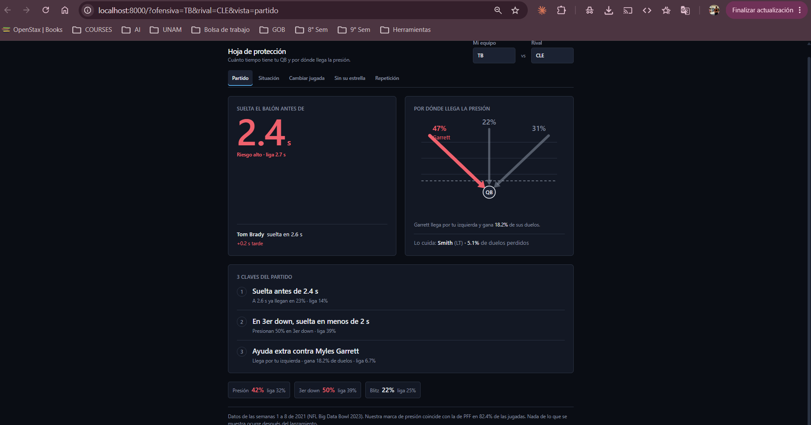

# Hoja de Protección

Construimos una herramienta para el coordinador ofensivo: elige su equipo y el rival y ve cuánto tiempo tiene su QB antes de la presión, por dónde llega y 3 acciones concretas.
Revela, por ejemplo, que contra Cleveland el QB tiene 2.4 s (liga 2.7 s) y que la presión llega 47% por la izquierda, donde Myles Garrett gana 18% de sus duelos.
La usarían coordinadores ofensivos y entrenadores de QB para preparar el partido y decidir en 3er down, con 8,533 jugadas de tracking validadas con PFF (82% de acuerdo).

Equipo: Octavio Salgado y Diego Varela Jimenez. Trabajo realizado durante el hackathon NFL Big Data Bowl · UNAM 2026, solo por los participantes.